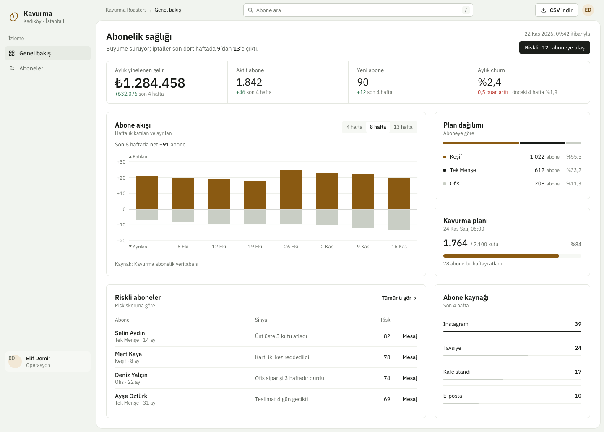

# Kavurma — abonelik sağlığı

Küçük bir BI dashboard demosu. Kavurma Roasters'ın (kurgusal bir İstanbul kavurmacısı) aylık kahve aboneliğini izler: büyüme churn'ü yeniyor mu, aboneler hangi planlarda, bu hafta kaç kutu kavrulacak ve kim ayrılmak üzere?

**Canlı demo:** <https://kavurma.quotic.xyz>



## Çalıştırma

Bağımlılık, build adımı veya API yok. Depoyu indirip `index.html`'i tarayıcıda açabilirsin; yerel sunucu tercih edersen:

```bash
python3 -m http.server 4173
```

Sonra <http://localhost:4173> adresini aç. Uygulama `#giris` kapısıyla açılır.

## Giriş ve roller

Bu demo, gerçek bir müşteri uygulaması gibi davranması için istemci tarafında çalışan **sahte bir giriş** ve rol modeli içerir. Sunucu, çerez veya gerçek şifre doğrulaması yoktur; hesaplar ve şifreler bilerek giriş kartında gösterilir. Bu bir güvenlik kontrolü değildir, yalnızca demo/QA içindir.

| E-posta | Şifre | Rol | Ad |
| --- | --- | --- | --- |
| `admin@kavurma.co` | `Kavurma!Admin1` | `admin` (Yönetici) | Elif Demir |
| `ops@kavurma.co` | `Kavurma!Ops1` | `operations` (Operasyon) | Deniz Acar |
| `viewer@kavurma.co` | `Kavurma!Viewer1` | `viewer` (İzleyici) | Ece Yılmaz |

Giriş kartındaki bir demo hesabına tıklamak e-posta ve şifre alanlarını doldurur; form klavyeyle de gönderilebilir.

| Yetki | `admin` | `operations` | `viewer` |
| --- | --- | --- | --- |
| Genel bakış | ✓ | ✓ | ✓ |
| Aboneler, arama/filtre/sıralama | ✓ | ✓ | ✓ |
| Abone detayı | ✓ | ✓ | ✓ (salt okunur) |
| Aksiyonlar görünümü | ✓ | ✓ | — |
| CSV indir | ✓ | ✓ | — |
| Mesaj taslağı | ✓ | ✓ | — |
| Aksiyon çöz / yeniden aç | ✓ | ✓ | — |

Davranış:

- Giriş başarılı olduğunda `{email, role, name, title}` kaydı `sessionStorage` içinde `kavurma.session` anahtarıyla tutulur ve `#genel-bakis` açılır. `localStorage` kullanılmaz.
- Aynı sekmede sayfa yenilenirse oturum korunur; yeni tarayıcı oturumu kapalı başlar.
- Kenar çubuğundaki **Çıkış yap** düğmesi kaydı siler ve `#giris` adresine döner.
- Oturum yokken `#giris` dışındaki bütün adresler `#giris`'e yönlenir. `viewer` rolü `#aksiyonlar` adresine doğrudan girdiğinde `#genel-bakis`'e yönlendirilir ve kısa bir bilgi gösterilir.
- Kenar çubuğundaki kullanıcı kartı oturum açan kişinin adını ve unvanını gösterir; `viewer` için Aksiyonlar bağlantısı, CSV, mesaj ve aksiyon düğmeleri gizlenir.

## Neler var

- **Giriş** — `#giris` adresindeki demo giriş kapısı; üç hesap, satır içi hata ve şifre göster/gizle. Oturum yokken diğer adresler buraya yönlenir.
- **Dört KPI** — aylık yinelenen gelir, aktif abone, yeni abone, aylık churn. Değişimler son 4 haftaya göre hesaplanır; referans dönem her etiketin yanında yazar.
- **Abone akışı** — haftalık katılan/ayrılan sütunları, 4 / 8 / 13 hafta arasında geçiş. Net değer grafiğin üstünde.
- **Plan dağılımı** — Keşif, Tek Menşe ve Ofis planlarının abone sayıları; çubuklar gerçek payı gösterir.
- **Kavurma planı** — bu haftanın kutu/kapasite oranı, atlayan abone sayısı ve bir sonraki kavurma.
- **Riskli aboneler** — risk skoruna göre sıralı liste. Her satırdaki **Mesaj** düğmesi, müşteriye özel bir taslak açar; taslağı düzenleyip panoya kopyalayabilir veya e-posta uygulamasında açabilirsin.
- **Aboneler** — 24 kişilik tam liste; arama, Tümü/Riskli/Sağlıklı filtresi ve sıralama. Mobilde tablo, tüm alanları koruyan iki satırlı kartlara dönüşür.
- **Abone detayı** — bir aboneye (tablo satırı, kart veya riskli abone satırı) tıklayınca sağdan detay çekmecesi açılır: risk skoru ve durumu, plan, üyelik süresi, son kutu, sinyal ve e-posta. Çekmeceden e-posta kopyalanabilir veya kişiye özel mesaj taslağı açılabilir.
- **Aksiyonlar** — teslimat, ödeme ve geri kazanım kuyruğu; kategori/durum filtresi, telafi veya çözüm kaydı, çözüldü/yeniden aç ve mesaj taslağına geçiş. Yalnızca `admin` ve `operations` rolleri görür.
- **CSV indir** — haftalık akışı ve abone listesini tek dosyada indirir. `viewer` rolünde gizlidir.
- Klavye: `/` aramaya gider, `Esc` açık katmanı kapatır, tüm kontroller klavyeyle kullanılabilir.

## Veri

Bütün sayılar `assets/data.js` içinden gelir. Toplamlar satırlardan hesaplanır; dosyanın sonundaki `console.assert` kontrolleri plan toplamlarını, haftalık netleri, kanal toplamını ve riskli abone sayısını birbirine bağlar:

```js
console.assert(totalSubs === snapshot.activeSubscribers, ...);
console.assert(sum(channels, 'value') === 90, ...);
```

Demo verisi gerçek değildir. İsimler, e-posta adresleri (`@kavurma.co`), tutarlar ve tarihler örnek olarak yazıldı; gerçek kullanımda değiştirilmelidir. Para birimi TRY, tarihler 22 Kasım 2026 anlık görüntüsüdür.

## Yapı

```
index.html          tek sayfa; giriş kapısı + üç görünüm (genel bakış, aboneler, aksiyonlar)
assets/app.css      tema tokenları, kabuk, paneller, giriş kartı, mobil düzen
assets/app.js       oturum ve rol kapısı, hesaplar, grafikler, yönlendirme, mesaj taslağı, CSV
assets/data.js      demo verisi, demo hesapları ve tutarlılık kontrolleri
assets/charts.js    bağımlılıksız SVG grafik yardımcıları
assets/fonts/       IBM Plex Sans + Mono (self-hosted, OFL)
assets/fonts.css    @font-face tanımları
```

Tasarım: tinted L-frame + beyaz çalışma sayfası; veri rengi kavurma amberi. IBM Plex Sans metin, IBM Plex Mono yalnızca kimlikler, anahtarlar ve demo giriş bilgileri için.

## Sınırlar

- Giriş ve roller **sahtedir**: istemci tarafında çalışır, sunucuda doğrulanmaz ve bir güvenlik sınırı oluşturmaz. Şifreler herkese açık demo değerleridir; gerçek kullanıcı veya müşteri verisiyle kullanılmamalıdır.
- Canlı veri, API, gerçek mesaj gönderimi ve kalıcı aksiyon kaydı yok. Mesaj düğmesi yalnızca panoya kopyalar veya `mailto:` açar; çözülen aksiyonlar sayfa yenilenince sıfırlanır.
- Giriş kapısı, rol kontrolü, grafikler ve filtreler JavaScript gerektirir. JavaScript kapalıyken uygulama kabuğu açılmaz.
- `file://` ile açılış desteklenir; yerel sunucu, tarayıcı kısıtlamalarını tamamen ortadan kaldırır.
